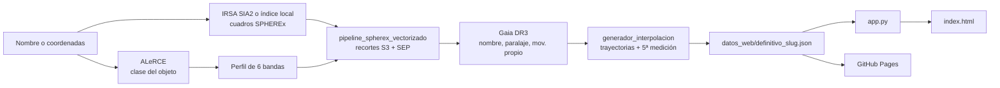

# SPHEREx Stellarium Explorer

Visor web del cielo infrarrojo de **SPHEREx** (NASA) para ver cómo cambian los objetos con el tiempo: cuánto se mueven, cómo varía su brillo y cómo es su espectro en 6 bandas entre 0,75 y 5 µm. Lo desarrollamos para el desafío **"Planet X and SPHEREx"** del NASA Space Apps Challenge 2026.

El sitio cruza las imágenes de SPHEREx con **Gaia DR3**, **ALeRCE**, **SIMBAD** y **AllWISE** para identificar cada fuente del campo. Con las mediciones de cada objeto ajusta su ecuación de movimiento y extrapola una quinta medición.

**Versión en línea:** https://wobaoba.github.io/spherex-explorer/. Es la versión estática; más abajo se explica qué funciones necesitan el servidor local.

---

## Qué se puede hacer

- **Explorar los 5 objetivos del desafío:** Barnard's Star, Epsilon Indi B, WISE 0855, RW Aurigae y R Draconis. También se puede buscar cualquier objeto por nombre (SIMBAD) o por coordenadas.
- **Recorrer el tiempo:** 4 mediciones del satélite más una extrapolada, un deslizador de fecha (MJD), animación y horizonte de +100 años según las ecuaciones de movimiento.
- **Cambiar de banda infrarroja:** el espectro de 6 puntos del objeto se actualiza en el panel.
- **Inspeccionar un objeto con un clic:** se abre una tarjeta con la imagen óptica (DSS2), un parpadeo entre la primera y la última época con píxeles reales de S3, y un GIF de SPHEREx en modo resta o directo con las fuentes identificadas.
- **Ver los píxeles FITS reales** del centro del campo, en la época inicial y en la final.
- **Leer los datos físicos:** posición actual, movimiento propio, velocidad tangencial, distancia, masa, temperatura y composición. Cada valor indica su origen: referencia de la literatura o medición Gaia más SPHEREx.
- **Generar videos del cielo** en una página aparte (`gif.html`): imágenes alineadas por fecha, en modo directo, resta o resta con el cuadro anterior, con identificación de fuentes opcional. La vista queda en la URL para compartirla.

---

## Estructura del proyecto

| Archivo | Qué hace |
|---|---|
| `index.html` | Interfaz principal: mapa (Aladin Lite + capa vectorial), panel del objeto, tarjetas de imágenes y control de tiempo. |
| `app.py` | Servidor FastAPI de la interfaz principal (puerto 8000). |
| `generador_json_definitivo.py` | Orquesta todo: resuelve el objetivo, consulta ALeRCE, busca cuadros en IRSA, ejecuta el pipeline, cruza con Gaia, calcula trayectorias y propiedades físicas, y guarda `datos_web/definitivo_<slug>.json`. Contiene el catálogo de los 5 objetivos (`OBJETIVOS_CHALLENGE`). |
| `pipeline_spherex_vectorizado.py` | Lee los FITS desde S3, recorta el campo, detecta fuentes con SEP, calibra la fotometría (µJy, magnitud AB) y arma el espectro de 6 bandas por fuente. |
| `test_identificacion_gaia_alerce.py` | Funciones de ALeRCE (clase del objeto central) y de Gaia DR3 (nombre, paralaje y movimiento propio de cada fuente, propagados a la fecha de SPHEREx). |
| `generador_interpolacion.py` | Ajusta RA(t) y Dec(t) de cada cuerpo y construye la quinta medición extrapolada. |
| `precargar_gifs.py` | Genera una sola vez los GIF de los 5 objetivos (modo resta y directo) en `datos_web/gifs/`. |
| `gif.html` · `gif_api.py` | Página y API (puerto 8001) que solo generan el video del cielo. |
| `spherex_video.py` | Motor del video: busca imágenes en IRSA, descarga recortes, enmascara FLAGS, reproyecta a una grilla común (norte arriba), resta el fondo y arma el GIF. También se usa desde la línea de comandos. |
| `identificar.py` | Detecta y verifica fuentes (prueba de las dos mitades, avisos de fantasma) y las identifica cruzando ALeRCE, SIMBAD, Gaia y WISE. Mide variabilidad dentro de los propios datos de SPHEREx. |
| `alerce_capa.py` · `asteroides_capa.py` · `catalogos.py` | Consultas a ALeRCE (ZTF/LSST), SkyBoT (asteroides conocidos en cada cuadro), SIMBAD, AllWISE y Gaia DR3, con caché. |
| `objetivos.py` | Resuelve un nombre en SIMBAD y propaga la posición con su movimiento propio a la fecha de cada imagen. |
| `fotometria.py` | Fotometría de apertura del objetivo en cada cuadro: espectro y curva de luz. |
| `test_consistencia.py` | Verifica que la ecuación de movimiento de Python y la de `index.html` den el mismo resultado. |
| `requirements.txt` · `instalar.bat` · `iniciar_api_gif.bat` | Dependencias y accesos directos para Windows. |
| `datos_web/` | Datos generados: JSON por objetivo, `indice_challenge.json` y `gifs/`. |

### Flujo de datos



Si IRSA o S3 no responden, `generador_json_definitivo.py` crea un **catálogo simulado** con el mismo formato. Ese catálogo queda marcado `es_simulado: true` y sus fuentes se llaman `SIM-###`, y la página muestra un aviso en rojo.

---

## Instalación

Requiere **Python 3.10 o superior**; el código usa la sintaxis `str | None`.

```powershell
python -m venv venv
venv\Scripts\activate
pip install -r requirements.txt sep s3fs
```

> `requirements.txt` cubre el motor del video. La interfaz principal además necesita `sep` (detección de fuentes) y `s3fs` (lectura de los FITS desde S3), que por eso se agregan en el comando. `instalar.bat` instala solo `requirements.txt`.

En macOS o Linux, activa el entorno con `source venv/bin/activate`.

---

## Uso

### 1. Generar los datos de los objetivos

```powershell
python generador_json_definitivo.py                    # los 5 objetivos
python generador_json_definitivo.py --objeto "RW Aur"  # uno por nombre
python generador_json_definitivo.py --ra 133.7951 --dec -7.2451
```

Cada objetivo queda en `datos_web/definitivo_<slug>.json`.

- **Datos reales:** se ven líneas `Procesando Epoch X | Banda Y...` en la terminal.
- **Catálogo simulado:** si esas líneas no aparecen, el archivo es el catálogo de respaldo.

### 2. Precargar los GIF (opcional, recomendado para la demo)

```powershell
python precargar_gifs.py                   # 5 objetivos × 2 modos
python precargar_gifs.py --solo wise_0855  # uno solo
python precargar_gifs.py --forzar          # rehacer los existentes
```

Si alguno falla, por ejemplo porque IRSA no responde, vuelve a ejecutarlo más tarde: solo genera los que faltan.

### 3. Levantar la interfaz principal

```powershell
uvicorn app:app --host 0.0.0.0 --port 8000
```

- **En tu computador:** http://localhost:8000
- **Desde otros equipos de la misma red:** `http://<tu-IP>:8000`. Obtén la IP con `ipconfig`, en la línea "Dirección IPv4".

Si los demás no logran conectarse, abre el puerto en una PowerShell de administrador:

```powershell
netsh advfirewall firewall add rule name="SPHEREx 8000" dir=in action=allow protocol=TCP localport=8000
```

### 4. Página de video (opcional)

```powershell
iniciar_api_gif.bat
```

o bien:

```powershell
python -m uvicorn gif_api:app --host 0.0.0.0 --port 8001
```

Abre http://localhost:8001. La vista se puede compartir por URL, por ejemplo:

```
http://localhost:8001/gif.html?objeto=Barnard's%20Star&modo=resta&detector=1&identificar=true
```

### 5. Video desde la línea de comandos

```powershell
python spherex_video.py --objeto "Barnard's Star" --detector 1 --modo resta --alerce
python spherex_video.py --objeto "RW Aur" --detector 6 --apilar --fotometria
python spherex_video.py 133.7951 -7.2451 --fov 0.1 --detector 6 --modo anterior
python spherex_video.py --objeto "R Dra" --listar      # solo lista las imágenes disponibles
```

Opciones útiles:
- `--asteroides`: marca los asteroides conocidos, según SkyBoT.
- `--coleccion spherex_dr1,spherex_qr3`: junta ambas entregas para tener más fechas.
- `--max N`: limita el número de cuadros.

Genera el GIF, un `.json` con los metadatos de cada cuadro y, según las opciones, un CSV de identificación (`--alerce`), una imagen apilada en PNG y FITS (`--apilar`), y el espectro con la curva de luz (`--fotometria`, que necesita `--objeto`).

---

## API

### `app.py` (puerto 8000)

| Endpoint | Descripción |
|---|---|
| `GET /api/health` | Estado y número de JSON precalculados. |
| `GET /api/challenge-targets` | Los 5 objetivos, indicando si ya están precalculados. |
| `GET /api/timeline?q=&ra=&dec=&fov=&clase=&forzar_vivo=` | JSON completo de un campo. Usa el archivo de `datos_web/` si existe. |
| `GET /api/posicion-tiempo?slug=&mjd=` | Posición de cada cuerpo en una fecha MJD. |
| `GET /api/inspect_pixels?ra=&dec=&fov_deg=` | Primera y última época desde S3, en PNG base64 con sus esquinas en el cielo. |
| `GET /api/cutout-png?ra=&dec=&fov=&epoch_idx=0\|1` | Recorte FITS real como PNG. |
| `GET /api/gif?objeto=&ra=&dec=&fov=&modo=&identificar=...` | GIF del campo. Si es un objetivo del desafío y está en `datos_web/gifs/`, lo entrega sin recalcular. |
| `GET /api/suggest?q=` · `GET /api/resolve?name=` | Autocompletado y resolución de nombres (objetivos y SIMBAD). |

### `gif_api.py` (puerto 8001)

| Endpoint | Descripción |
|---|---|
| `GET /api/gif?objeto=\|ra,dec&fov=&detector=&modo=&identificar=&fps=` | GIF en memoria. Guarda en caché los últimos 30. |
| `GET /api/health` | Estado. |

---

## Publicar en GitHub Pages

GitHub Pages solo sirve archivos estáticos: ahí no corre Python. `index.html` lo detecta y en ese caso lee los JSON y GIF de `datos_web/` directamente.

Archivos que se publican:

```
index.html
datos_web/definitivo_barnards_star.json
datos_web/definitivo_epsilon_indi_b.json
datos_web/definitivo_wise_0855.json
datos_web/definitivo_rw_aurigae.json
datos_web/definitivo_r_draconis.json
datos_web/gifs/*.gif          (opcional, de precargar_gifs.py)
```

Pasos con Git:

```powershell
git add index.html datos_web
git commit -m "Actualizar datos"
git push
```

Después activa el sitio en **Settings → Pages → Deploy from a branch → main / (root)**.

| Función | Servidor local | GitHub Pages |
|---|---|---|
| Mapa, 5 objetivos, espectro, bandas, tiempo | ✓ | ✓ |
| Búsqueda libre por nombre o coordenadas | ✓ | Solo los 5 objetivos |
| Imagen óptica DSS2 | ✓ | ✓ |
| Parpadeo con píxeles S3 y recorte FITS | ✓ | — |
| GIF del objeto central | ✓ | ✓ si está precargado |
| GIF de otras fuentes del campo | ✓ | — |
| `gif.html` | ✓ | — |

---

## Formato de `definitivo_<slug>.json`

| Campo | Contenido |
|---|---|
| `centro_campo` | `ra`, `dec`, `fov_deg` del recorte. |
| `epochs[]` | 4 mediciones y la extrapolada. Cada una trae `mjd_promedio`, `tipo_medicion` (`observada_spherex`, `proyectada_gaia`, `simulada` o `extrapolada`), `catalogo_campo[]` con las fuentes y `bandas[]`. |
| `ecuaciones_trayectoria[]` | Por cuerpo: `ecuacion` (`t0_mjd`, `ra_0_deg`, `dec_0_deg`, `mu_ra_cosdec_mas_yr`, `mu_dec_mas_yr`, aceleraciones), `espectro_referencia`, morfología y `astrofisica`. |
| `astrofisica` | `origen_parametros`, tipo, velocidad tangencial, distancia, masa, densidad, temperatura y composición. Solo los 5 objetivos traen masa y composición, tomadas de la literatura; para el resto no se inventan. |
| `meta` | `nombre_objetivo`, `slug`, `origen_datos`, `es_simulado`, `bandas_disponibles[]`. |

**Perfiles de bandas** (`BANDAS_OBJETIVO_UM`, en µm):

| Perfil | Bandas |
|---|---|
| `DEFAULT` | 0.75, 0.82, 0.90, 0.97, 1.03, 1.10 |
| `BROWN_DWARF` | 0.85, 1.15, 1.60, 2.20, 3.35, 4.65 |
| `YSO` | 0.85, 1.25, 2.20, 3.05, 4.25, 4.65 |
| `AGN` | 0.80, 1.05, 1.65, 2.20, 3.40, 4.60 |
| `SN` | 0.75, 0.90, 1.08, 1.60, 2.15, 3.60 |
| `ASTEROID` | 0.78, 0.92, 1.05, 1.50, 2.00, 3.00 |

Perfil de cada objetivo: Barnard's Star y R Draconis usan `DEFAULT`; Epsilon Indi B y WISE 0855, `BROWN_DWARF`; RW Aurigae, `YSO`.

---

## Pruebas

```powershell
python test_consistencia.py
```

Comprueba que la ecuación de movimiento de Python y su espejo en JavaScript coinciden.

---

## Limitaciones conocidas

- **IRSA SIA2 falla a ratos** con errores 502 o 503 ("Proxy Error"). Cuando pasa, el generador usa el catálogo simulado y la página lo avisa. Para trabajar sin IRSA, `app.py` también busca índices locales de cuadros (`datos_web/input_*.json` con `ra`, `dec` y `cuadros`) antes de consultar IRSA.
- **ALeRCE puede imponer `DEFAULT`:** si encuentra un objeto sin clase en la posición, su perfil reemplaza al del objetivo. Esto le ocurrió a R Draconis, aunque ahí no cambia nada porque su perfil ya es `DEFAULT`.
- **El perfil `DEFAULT` cubre solo el detector 1 (0,75–1,10 µm).** Las enanas marrones frías son muy débiles ahí y brillan a 3–5 µm.
- **Objetos rápidos fuera del campo:** WISE 0855 (unos 8″ por año), Barnard's Star (unos 10″ por año) y Epsilon Indi B pueden quedar lejos del centro de un recorte pequeño en 2025–2026. Aumentar `fov` ayuda.
- **El movimiento propio ajustado con posiciones de SPHEREx** (píxeles de 6,2″) es poco preciso para estrellas lentas. Las épocas que faltan se proyectan con la cinemática de Gaia DR3 o con los valores de referencia de los objetivos.
- **URLs compartibles:** solo `gif.html` lee la vista desde la URL; `index.html` todavía no.

---

## Fuentes de datos y créditos

- **SPHEREx** — NASA/JPL-Caltech, datos servidos por **IRSA** (NASA/IPAC) y el bucket público de AWS `s3://nasa-irsa-spherex/`.
- **Gaia DR3** — ESA/Gaia/DPAC.
- **ALeRCE** — broker de alertas astronómicas (ZTF y LSST/Rubin).
- **SIMBAD**, **Aladin Lite** y **hips2fits** — CDS, Estrasburgo.
- **AllWISE** — NASA/IPAC; **DSS2** vía HiPS de CDS.
- **SkyBoT** — IMCCE, Observatorio de París.
- Bibliotecas: Astropy, Astroquery, reproject, SEP, NumPy, SciPy, Matplotlib, Pillow, imageio, FastAPI.

Proyecto desarrollado para el **NASA Space Apps Challenge 2026**.

### Pendientes
- Reordenar los archivos en una estructura más amena, una carpeta src para los scripts y una carpeta frontend para el deploy
- Colocar un screenshot al README.md
- Actualizar el nombre del repositorio a SpheriumX
